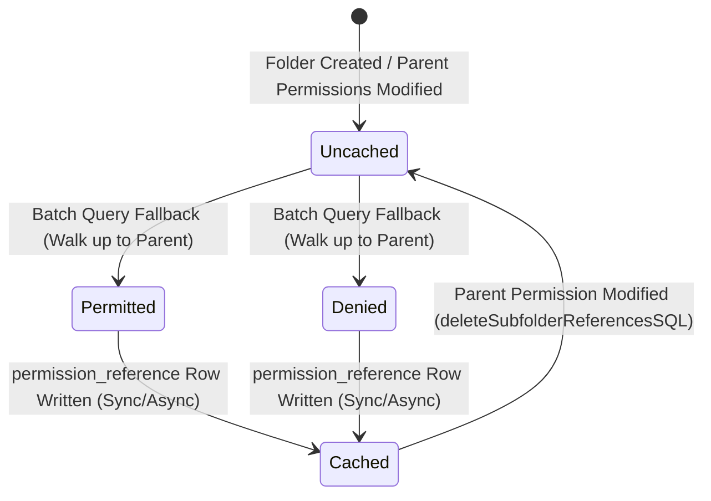

# Data Model: Content Drive Folder Permission Fallback (#37749)

## Entities & Tables

### 1. `permission_reference`
Maintains cached links between an inheriting asset and the parent asset from which it inherits inheritable permissions.

| Column | Type | Description |
|---|---|---|
| `id` | bigint / serial | Primary key (sequence generated) |
| `asset_id` | varchar(36) | Inode or Identifier of the inheriting asset (e.g., child folder) |
| `reference_id` | varchar(36) | Inode or Identifier of the ancestor asset providing permissions |
| `permission_type` | varchar(100) | Canonical class name of the asset type (e.g., `com.dotmarketing.portlets.folders.model.Folder`) |

### 2. `permission`
Stores individual and inheritable permission bits assigned to roles.

| Column | Type | Description |
|---|---|---|
| `id` | bigint | Primary key |
| `inode_id` | varchar(36) | Target asset Inode or Identifier |
| `permission_type` | varchar(255) | `individual` for direct grants, or canonical class name for inheritable permissions |
| `roleid` | varchar(36) | ID of the role receiving the permission |
| `permission` | bigint / int | Bitwise permission mask (`1` = READ, `2` = EDIT/WRITE, `4` = PUBLISH, `8` = EDIT_PERMISSIONS, `16` = CAN_ADD_CHILDREN) |

### 3. In-Memory Structures

#### `BatchPermissionsResult` (New value object)
Represents the result of querying a collection of IDs against the database:

```java
public static class BatchPermissionsResult {
    private final Set<String> permittedIds;
    private final Set<String> uncachedIds;

    public BatchPermissionsResult(Set<String> permittedIds, Set<String> uncachedIds) {
        this.permittedIds = permittedIds;
        this.uncachedIds = uncachedIds;
    }

    public Set<String> getPermittedIds() {
        return permittedIds;
    }

    public Set<String> getUncachedIds() {
        return uncachedIds;
    }
}
```

---

## State Lifecycle & Transitions



1. **Uncached State**:
   - `permission_reference` has no row where `asset_id = folder.inode`.
   - `permission` has no row where `inode_id = folder.inode` and `permission_type = 'individual'`.
2. **Identification State**:
   - Batch SQL query detects that the ID is neither in `permitted_ids` nor in `cached_ids`.
   - Flagged as `uncached`.
3. **Walk-Up & Resolution**:
   - A `PermissionableProxy` (the Publishing Queue filters proxies built from a bundle's asset id) has no parent, so it is first resolved to the real asset through `AssetPermissionHelper.resolveAsset`; an id that resolves to nothing keeps the proxy and ends up denied, as today.
   - `PermissionBitFactoryImpl.loadPermissions()` resolves parent permissions (`_loadParentPermissions`).
   - Permissions evaluated against requesting user's `roleIds` and required `permissionType`.
   - Asynchronous or synchronous upsert into `permission_reference` is scheduled/executed.
4. **Cached State**:
   - Subsequent batch SQL queries resolve the asset directly via the `permission_reference` join in a single query.
